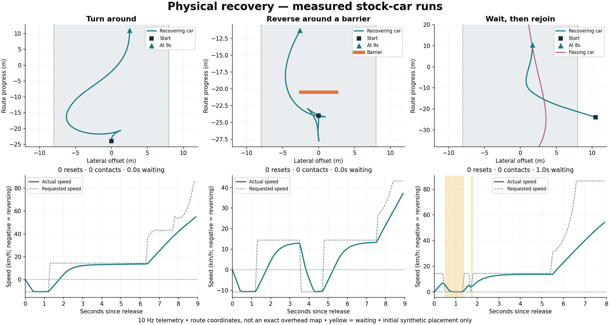

# Physical recovery: first validated scenario suite

21 September 2026. Bounded progress in phase C of the agreed AI plan; the overall goal remains active. The preceding goal work made progress on the reference driver and recovery candidates. The intervening answer locating the driver classes made no implementation progress; this continuation rechecked the actual processes, source and reports before proceeding.

## Player-visible behaviour and implementation

An opted-in AI car can now brake, reverse, turn around, wait for clearance, return behind a missed checkpoint and rejoin through ordinary pedal/steering inputs. `PhysicalRecovery` chooses actions; `RecoverySensor` checks static swept space and predicted traffic occupancy. `RoadCar` retains the shared force and checkpoint logic. Synthetic fixture placement is explicitly separate from subsequent recovery and cannot award gates. Assisted relocation remains separately counted.

The wrong-way pilot originally alternated ineffective turns. Steering commitment now follows yaw direction across forward/reverse gear changes, with a short gear commitment. The stock traffic fixture exposed a different defect: the road-edge allowance used half the car's length, underestimating a diagonal body's lateral footprint. It now derives the initial allowance from both oriented dimensions.

The wall case exposed premature handoff to the normal driver: straight-ahead clearance did not ensure that returning to the racing line cleared the wall. Handoff now checks a blended path back to the reference line. Existing safety-envelope overlap can only be exited in a direction that reduces that overlap. An isolated regression revealed that the initially inactive query collider did not provide the required penetration result on this runtime. The final query is a registered trigger below the world, separate from the car's compound body and disposed with its sensor. It never modifies car mass, inertia, position or forces.

Unity's [ComputePenetration API](https://docs.unity3d.com/6000.0/Documentation/ScriptReference/Physics.ComputePenetration.html) is used only to assess hypothetical clearance. The editor and actual driving regressions, rather than the documentation alone, establish the behaviour described here.

## Evidence

Frozen candidate: `outputs/little-road-recovery-08-review/Little Road Unity.exe` relative to the workspace. Assembly SHA256: `650ECA2A21FB8CBA8422FC03CFC9B3D221347A48284DC456735DF0BA58F19F39`.

- `unity-30/editor-checks-08.json`: **224 editor checks**, including four sensor regressions for diagonal shoulder clearance, an initially nonpenetrating body, a detected wall margin, and permitted reverse escape with rejected forward movement.
- `unity-30/matrix-08/analysis.json`: **92/92 checks across 14 physical runs**, stock and club in seven scenarios. Every entrant finishes, with zero contacts, assisted resets or overlap at/above the 2 cm acceptance limit. Every run exits normally with process exit code 0. Full per-tick maximum displacement remains below 0.5 m; this is separate from the 10 Hz trajectory record.
- Missed-gate fixtures physically return behind the unearned gate before a valid crossing. Other fixtures have no missed gates.
- Blocked-wait fixtures wait about nine seconds, beyond the previous six-second stuck threshold, then finish. These barriers disappear at a declared fixture time; this is not proof of traffic prediction.
- Separate two-car traffic fixtures yield for about one second, observe the approaching car pass before racing resumes, and both cars finish without contact.
- `unity-30/regressions-08.json`: **15/15 checks**. The three-lap club reference and existing Bayview 24-car legacy race reproduce their frozen outcome fields and timestamped motion/input traces exactly. Club best lap remains 64.9758 s. There are no new recovery/checkpoint failures; the clean reference has no sampled full-body road departures. Single-run launcher reports and normal shutdown logs are retained; their original process exit-code handles were not retained, unlike the 14-run matrix.

| Scenario | Stock recovery time | Club recovery time |
| --- | ---: | ---: |
| Sideways | 1.93 s | 1.60 s |
| Wrong way | 6.39 s | 3.57 s |
| Off road | 5.55 s | 5.31 s |
| Wall | 12.95 s | 8.62 s |
| Missed gate | 7.38 s | 6.85 s |
| Blocked wait | 9.32 s | 9.17 s |
| Approaching traffic | 5.51 s | 5.00 s |

These are total time in recovery states, not lap penalties. The fixed wall is encountered both before the initial start-line crossing and again at the lap's end, so wall totals include two completed recoveries. All starts are in the same straight section with the compact body; equipment changes do not imply body-coverage validation.

Failed evidence is retained. Matrix 02 passes only 83/90 original checks, with stock wrong-way resets, a wall timeout and a traffic wait lasting the full timeout. Build 04 still leaves the stock wall/traffic cases waiting. Build 05 identifies all 22 traffic options as corridor-rejected and the late wall options as statically blocked. Matrix 06 passes 92/92 enhanced checks, but build 07 and focused checks 08–10 expose the isolated query-shape regression. Build 08 fixes it and repeats the complete physical suite. No failed run is relabelled as acceptance.

The plot was generated from the final run data and visually inspected for legibility. It uses route coordinates and sampled trajectories, not an exact overhead map or gameplay recording. It does not establish moving visual acceptance.

## Playable checkpoint and quality review

`Watch Physical Recovery.cmd` launches a fullscreen stock-car wall scenario, followed by a complete lap, in the frozen review build. It uses the existing verified technical-trial launcher and captures live-camera images; this new shortcut has not received a separate interactive desktop review. Recovery state, physical rejoins, assisted resets and waiting time are displayed in its test HUD. The normal desktop adventure remains checkpoint 20.

| Review area | Current evidence and remaining work |
| --- | --- |
| Visual quality | No vehicle/world art changed. Cedar remains plain engineering scenery; inspect moving recovery and HUD readability before calling the behaviour polished |
| Driving and races | The declared recovery suite passes and baseline commands remain exact. General overtaking, corner recovery, high-speed spins, larger bodies and dense queues remain unproved |
| Progression and exploration | No campaign content, earnings, equipment catalogue or resident changes; these fixtures add no meaningful campaign hours |
| Usability and controller | Replay entry point supplied. No new physical DualSense/fullscreen/manual acceptance is claimed |
| Performance | Bounded option arrays and 10 Hz planning are implemented; simultaneous headless tests do not establish rendering performance or the 24-car recovery CPU budget |
| Production readiness | Opt-in review feature only; normal race AI remains legacy. Not ready for blanket production enabling |

## Known defects and next work

Follow-up: [iteration 39](iteration-39-blocked-recovery-and-preview.md) addresses the permanent stationary-blockage timeout and safe assisted placement, adds longer temporary waits, and records the first sampled live recovery review. The findings below describe this earlier checkpoint.

The generic wait state currently suppresses the unproductive timer. A genuinely permanent geometric blockage can therefore wait indefinitely, just as legitimate traffic waiting is protected. Before production, distinguish moving-traffic waits from persistent geometric dead ends and test an explicit safe assisted fallback. The current suite proves nine-second waiting and subsequent release, not permanent-trap resolution.

Rejoin sampling uses a simplified kinematic prediction and conservative fixed dimensions for other cars. Future body envelopes, rotating traffic, corner topology, supported shoulders, reversing after existing contact and clearance under fast spins need dedicated cases. There is no general multi-car traffic policy yet, and this reference driver is not authorised for ordinary 24-car racing by these tests.

Next: inspect the recovery replay, cover the unresolved permanent-blockage case, then implement the bounded two-/three-car traffic layer. Use the user's reverse-speed queue, feasible/unsafe braking-zone pass and later skill-versus-equipment scenarios in `docs/27-recovery-and-racecraft-fixtures.md`. Keep vehicle capability, skill and aggression separate. The first human-review AI slice remains three differentiated drivers with credible physical recovery, before scaling to the full field.
