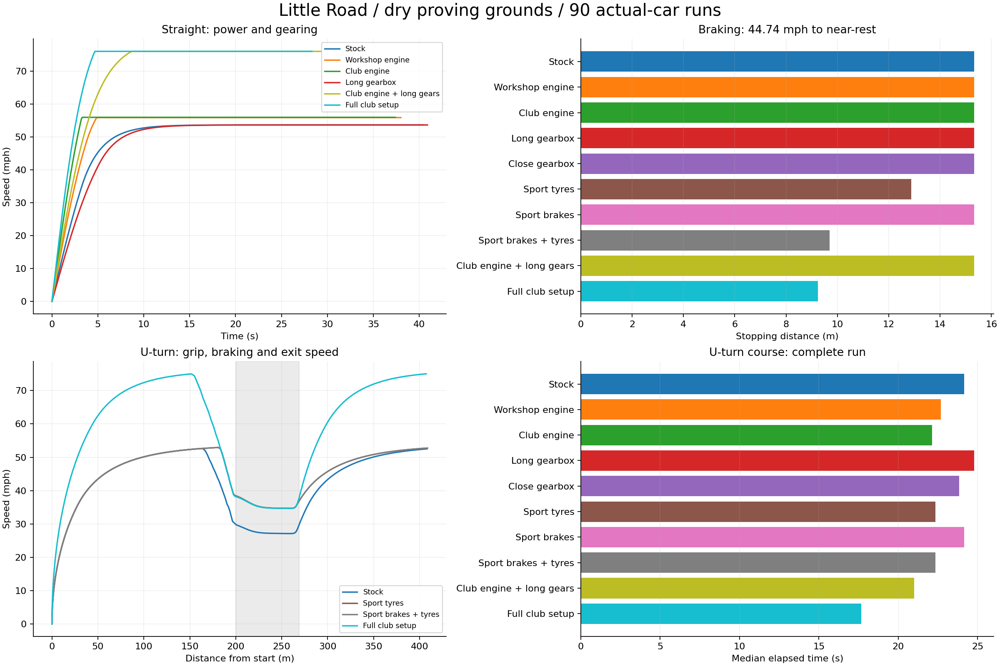

# Dry-road equipment measurements

90 actual-car runs. Validation: **PASS**.

Three repeats per course/loadout are intended to establish controlled repeatability, not natural driver variance. The production RoadCar/PhysX handles every force and contact. Dry fixtures only; hill, wet/off-road and seeded AI work remain pending.

| Course | Loadout | Valid/repeats | Median time | Time range | Average mph | 0–30 mph | Sustained mph | Stop distance | Apex mph |
| --- | --- | ---: | ---: | ---: | ---: | ---: | ---: | ---: | ---: |
| straight | stock | 3/3 | 40.400 s | 0.000 s | 49.841 | 2.698 s | 53.687 | — | — |
| straight | engine_workshop | 3/3 | 38.050 s | 0.000 s | 52.916 | 2.071 s | 55.927 | — | — |
| straight | engine_club | 3/3 | 37.433 s | 0.000 s | 53.795 | 1.527 s | 56.006 | — | — |
| straight | transmission_long | 3/3 | 40.925 s | 0.000 s | 49.201 | 3.296 s | 53.687 | — | — |
| straight | transmission_close | 3/3 | 41.342 s | 0.000 s | 48.708 | 2.201 s | 51.459 | — | — |
| straight | tyres_sport | 3/3 | 40.400 s | 0.000 s | 49.841 | 2.698 s | 53.687 | — | — |
| straight | brakes_sport | 3/3 | 40.400 s | 0.000 s | 49.841 | 2.698 s | 53.687 | — | — |
| straight | brakes_sport+tyres_sport | 3/3 | 40.400 s | 0.000 s | 49.841 | 2.698 s | 53.687 | — | — |
| straight | engine_club+transmission_long | 3/3 | 29.308 s | 0.000 s | 68.694 | 1.844 s | 76.065 | — | — |
| straight | club | 3/3 | 28.317 s | 0.000 s | 71.107 | 1.283 s | 76.076 | — | — |
| brake | stock | 3/3 | 1.583 s | 0.000 s | 21.666 | — | — | 15.335 m | — |
| brake | engine_workshop | 3/3 | 1.583 s | 0.000 s | 21.666 | — | — | 15.335 m | — |
| brake | engine_club | 3/3 | 1.583 s | 0.000 s | 21.666 | — | — | 15.335 m | — |
| brake | transmission_long | 3/3 | 1.583 s | 0.000 s | 21.666 | — | — | 15.335 m | — |
| brake | transmission_close | 3/3 | 1.583 s | 0.000 s | 21.666 | — | — | 15.335 m | — |
| brake | tyres_sport | 3/3 | 1.325 s | 0.000 s | 21.744 | — | — | 12.879 m | — |
| brake | brakes_sport | 3/3 | 1.583 s | 0.000 s | 21.666 | — | — | 15.335 m | — |
| brake | brakes_sport+tyres_sport | 3/3 | 0.992 s | 0.000 s | 21.885 | — | — | 9.702 m | — |
| brake | engine_club+transmission_long | 3/3 | 1.583 s | 0.000 s | 21.666 | — | — | 15.335 m | — |
| brake | club | 3/3 | 0.950 s | 0.000 s | 21.756 | — | — | 9.239 m | — |
| uturn | stock | 3/3 | 24.158 s | 0.000 s | 38.057 | 2.698 s | — | — | 27.099 |
| uturn | engine_workshop | 3/3 | 22.683 s | 0.000 s | 40.525 | 2.071 s | — | — | 27.100 |
| uturn | engine_club | 3/3 | 22.133 s | 0.000 s | 41.534 | 1.527 s | — | — | 27.099 |
| uturn | transmission_long | 3/3 | 24.792 s | 0.000 s | 37.077 | 3.296 s | — | — | 27.101 |
| uturn | transmission_close | 3/3 | 23.850 s | 0.000 s | 38.546 | 2.201 s | — | — | 27.098 |
| uturn | tyres_sport | 3/3 | 22.333 s | 0.000 s | 41.239 | 2.698 s | — | — | 34.672 |
| uturn | brakes_sport | 3/3 | 24.158 s | 0.000 s | 38.057 | 2.698 s | — | — | 27.099 |
| uturn | brakes_sport+tyres_sport | 3/3 | 22.333 s | 0.000 s | 41.227 | 2.698 s | — | — | 34.668 |
| uturn | engine_club+transmission_long | 3/3 | 21.008 s | 0.000 s | 43.762 | 1.844 s | — | — | 27.100 |
| uturn | club | 3/3 | 17.667 s | 0.000 s | 52.124 | 1.283 s | — | — | 34.665 |

Braking starts at 20 m/s (44.74 mph) and ends at ≤0.15 m/s. Times use completed physics steps; sector crossings are interpolated. The 900 m straight reports sustained speed only after a stable three-second window. U-turn values cover the whole approach/turn/exit run, with a 22 m centreline radius.

## Expectations and validity

- PASS — Batch is terminal and contains runs
- PASS — Every attempted run completed validly
- PASS — No recovery, impact or missed measured gate
- PASS — Same runtime assembly and physics step
- PASS — Dry-road runs remained on the measured road
- PASS — No unexplained lift on flat fixtures: Collider bottom clearance < 6 cm on these flat courses only.
- PASS — Full declared 90-run matrix is present
- PASS — straight/stock: at least three repeats
- PASS — straight/stock: repeatable elapsed time: Range 0.000000s; fixed-driver tolerance 0.0808s, not desired natural AI variance.
- PASS — stock: reached sustained speed plateau
- PASS — stock: garage speed estimate agrees with physical run: Tolerance 0.08 m/s covers fixed-step gearbox ceiling overshoot.
- PASS — stock: garage 0–30 estimate agrees with physical run: Independent actual-car measurement versus garage force-integration estimate; tolerance 0.04s.
- PASS — straight/engine_workshop: at least three repeats
- PASS — straight/engine_workshop: repeatable elapsed time: Range 0.000000s; fixed-driver tolerance 0.0761s, not desired natural AI variance.
- PASS — engine_workshop: reached sustained speed plateau
- PASS — engine_workshop: garage speed estimate agrees with physical run: Tolerance 0.08 m/s covers fixed-step gearbox ceiling overshoot.
- PASS — engine_workshop: garage 0–30 estimate agrees with physical run: Independent actual-car measurement versus garage force-integration estimate; tolerance 0.04s.
- PASS — straight/engine_club: at least three repeats
- PASS — straight/engine_club: repeatable elapsed time: Range 0.000000s; fixed-driver tolerance 0.0749s, not desired natural AI variance.
- PASS — engine_club: reached sustained speed plateau
- PASS — engine_club: garage speed estimate agrees with physical run: Tolerance 0.08 m/s covers fixed-step gearbox ceiling overshoot.
- PASS — engine_club: garage 0–30 estimate agrees with physical run: Independent actual-car measurement versus garage force-integration estimate; tolerance 0.04s.
- PASS — straight/transmission_long: at least three repeats
- PASS — straight/transmission_long: repeatable elapsed time: Range 0.000000s; fixed-driver tolerance 0.0819s, not desired natural AI variance.
- PASS — transmission_long: reached sustained speed plateau
- PASS — transmission_long: garage speed estimate agrees with physical run: Tolerance 0.08 m/s covers fixed-step gearbox ceiling overshoot.
- PASS — transmission_long: garage 0–30 estimate agrees with physical run: Independent actual-car measurement versus garage force-integration estimate; tolerance 0.04s.
- PASS — straight/transmission_close: at least three repeats
- PASS — straight/transmission_close: repeatable elapsed time: Range 0.000000s; fixed-driver tolerance 0.0827s, not desired natural AI variance.
- PASS — transmission_close: reached sustained speed plateau
- PASS — transmission_close: garage speed estimate agrees with physical run: Tolerance 0.08 m/s covers fixed-step gearbox ceiling overshoot.
- PASS — transmission_close: garage 0–30 estimate agrees with physical run: Independent actual-car measurement versus garage force-integration estimate; tolerance 0.04s.
- PASS — straight/tyres_sport: at least three repeats
- PASS — straight/tyres_sport: repeatable elapsed time: Range 0.000000s; fixed-driver tolerance 0.0808s, not desired natural AI variance.
- PASS — tyres_sport: reached sustained speed plateau
- PASS — tyres_sport: garage speed estimate agrees with physical run: Tolerance 0.08 m/s covers fixed-step gearbox ceiling overshoot.
- PASS — tyres_sport: garage 0–30 estimate agrees with physical run: Independent actual-car measurement versus garage force-integration estimate; tolerance 0.04s.
- PASS — straight/brakes_sport: at least three repeats
- PASS — straight/brakes_sport: repeatable elapsed time: Range 0.000000s; fixed-driver tolerance 0.0808s, not desired natural AI variance.
- PASS — brakes_sport: reached sustained speed plateau
- PASS — brakes_sport: garage speed estimate agrees with physical run: Tolerance 0.08 m/s covers fixed-step gearbox ceiling overshoot.
- PASS — brakes_sport: garage 0–30 estimate agrees with physical run: Independent actual-car measurement versus garage force-integration estimate; tolerance 0.04s.
- PASS — straight/brakes_sport+tyres_sport: at least three repeats
- PASS — straight/brakes_sport+tyres_sport: repeatable elapsed time: Range 0.000000s; fixed-driver tolerance 0.0808s, not desired natural AI variance.
- PASS — brakes_sport+tyres_sport: reached sustained speed plateau
- PASS — brakes_sport+tyres_sport: garage speed estimate agrees with physical run: Tolerance 0.08 m/s covers fixed-step gearbox ceiling overshoot.
- PASS — brakes_sport+tyres_sport: garage 0–30 estimate agrees with physical run: Independent actual-car measurement versus garage force-integration estimate; tolerance 0.04s.
- PASS — straight/engine_club+transmission_long: at least three repeats
- PASS — straight/engine_club+transmission_long: repeatable elapsed time: Range 0.000000s; fixed-driver tolerance 0.0586s, not desired natural AI variance.
- PASS — engine_club+transmission_long: reached sustained speed plateau
- PASS — engine_club+transmission_long: garage speed estimate agrees with physical run: Tolerance 0.08 m/s covers fixed-step gearbox ceiling overshoot.
- PASS — engine_club+transmission_long: garage 0–30 estimate agrees with physical run: Independent actual-car measurement versus garage force-integration estimate; tolerance 0.04s.
- PASS — straight/club: at least three repeats
- PASS — straight/club: repeatable elapsed time: Range 0.000000s; fixed-driver tolerance 0.0566s, not desired natural AI variance.
- PASS — club: reached sustained speed plateau
- PASS — club: garage speed estimate agrees with physical run: Tolerance 0.08 m/s covers fixed-step gearbox ceiling overshoot.
- PASS — club: garage 0–30 estimate agrees with physical run: Independent actual-car measurement versus garage force-integration estimate; tolerance 0.04s.
- PASS — brake/stock: at least three repeats
- PASS — brake/stock: repeatable elapsed time: Range 0.000000s; fixed-driver tolerance 0.0500s, not desired natural AI variance.
- PASS — brake/engine_workshop: at least three repeats
- PASS — brake/engine_workshop: repeatable elapsed time: Range 0.000000s; fixed-driver tolerance 0.0500s, not desired natural AI variance.
- PASS — brake/engine_club: at least three repeats
- PASS — brake/engine_club: repeatable elapsed time: Range 0.000000s; fixed-driver tolerance 0.0500s, not desired natural AI variance.
- PASS — brake/transmission_long: at least three repeats
- PASS — brake/transmission_long: repeatable elapsed time: Range 0.000000s; fixed-driver tolerance 0.0500s, not desired natural AI variance.
- PASS — brake/transmission_close: at least three repeats
- PASS — brake/transmission_close: repeatable elapsed time: Range 0.000000s; fixed-driver tolerance 0.0500s, not desired natural AI variance.
- PASS — brake/tyres_sport: at least three repeats
- PASS — brake/tyres_sport: repeatable elapsed time: Range 0.000000s; fixed-driver tolerance 0.0500s, not desired natural AI variance.
- PASS — brake/brakes_sport: at least three repeats
- PASS — brake/brakes_sport: repeatable elapsed time: Range 0.000000s; fixed-driver tolerance 0.0500s, not desired natural AI variance.
- PASS — brake/brakes_sport+tyres_sport: at least three repeats
- PASS — brake/brakes_sport+tyres_sport: repeatable elapsed time: Range 0.000000s; fixed-driver tolerance 0.0500s, not desired natural AI variance.
- PASS — brake/engine_club+transmission_long: at least three repeats
- PASS — brake/engine_club+transmission_long: repeatable elapsed time: Range 0.000000s; fixed-driver tolerance 0.0500s, not desired natural AI variance.
- PASS — brake/club: at least three repeats
- PASS — brake/club: repeatable elapsed time: Range 0.000000s; fixed-driver tolerance 0.0500s, not desired natural AI variance.
- PASS — uturn/stock: at least three repeats
- PASS — uturn/stock: repeatable elapsed time: Range 0.000000s; fixed-driver tolerance 0.0500s, not desired natural AI variance.
- PASS — uturn/engine_workshop: at least three repeats
- PASS — uturn/engine_workshop: repeatable elapsed time: Range 0.000000s; fixed-driver tolerance 0.0500s, not desired natural AI variance.
- PASS — uturn/engine_club: at least three repeats
- PASS — uturn/engine_club: repeatable elapsed time: Range 0.000000s; fixed-driver tolerance 0.0500s, not desired natural AI variance.
- PASS — uturn/transmission_long: at least three repeats
- PASS — uturn/transmission_long: repeatable elapsed time: Range 0.000000s; fixed-driver tolerance 0.0500s, not desired natural AI variance.
- PASS — uturn/transmission_close: at least three repeats
- PASS — uturn/transmission_close: repeatable elapsed time: Range 0.000000s; fixed-driver tolerance 0.0500s, not desired natural AI variance.
- PASS — uturn/tyres_sport: at least three repeats
- PASS — uturn/tyres_sport: repeatable elapsed time: Range 0.000000s; fixed-driver tolerance 0.0500s, not desired natural AI variance.
- PASS — uturn/brakes_sport: at least three repeats
- PASS — uturn/brakes_sport: repeatable elapsed time: Range 0.000000s; fixed-driver tolerance 0.0500s, not desired natural AI variance.
- PASS — uturn/brakes_sport+tyres_sport: at least three repeats
- PASS — uturn/brakes_sport+tyres_sport: repeatable elapsed time: Range 0.000000s; fixed-driver tolerance 0.0500s, not desired natural AI variance.
- PASS — uturn/engine_club+transmission_long: at least three repeats
- PASS — uturn/engine_club+transmission_long: repeatable elapsed time: Range 0.000000s; fixed-driver tolerance 0.0500s, not desired natural AI variance.
- PASS — uturn/club: at least three repeats
- PASS — uturn/club: repeatable elapsed time: Range 0.000000s; fixed-driver tolerance 0.0500s, not desired natural AI variance.
- PASS — Workshop engine materially improves 0–30 mph
- PASS — Club engine improves launch further
- PASS — Long gearing alone does not invent engine power/top speed
- PASS — Long gearing trades away some launch acceleration
- PASS — Close gearing improves launch but lowers maximum speed
- PASS — Powerful engine benefits from longer gearing
- PASS — Sport brakes alone meet the stock tyre ceiling: Expected current model limitation; no blanket assertion that every purchase improves every metric.
- PASS — Better tyres unlock more of the stock brakes
- PASS — Sport brakes add a benefit with sport tyres
- PASS — Road sport tyres improve corner speed and total U-turn run
- PASS — Road sport tyres do not invent extra engine top speed

## Limits and next decisions

These are bounded dry-road fixtures, not whole-game balance or physical-controller acceptance. The fixed reference policy deliberately removes AI skill variation. Its cornering margins and centring are identical policies across loadouts, but its chosen inputs adapt to equipment. Speed estimates agreeing here do not validate hill, fuel, tyre-wear, wet-road or off-road estimates. Use matched full-field races and first-time player feedback to assess whether early purchases feel worthwhile.

The reference policy caps braking reserve conservatively. Sport brakes plus sport tyres shorten the physical stopping test but do not improve the U-turn elapsed time over sport tyres alone in this batch. Treat this as a driver-policy limit; these laps are not the ideal performance ceiling of each loadout.

