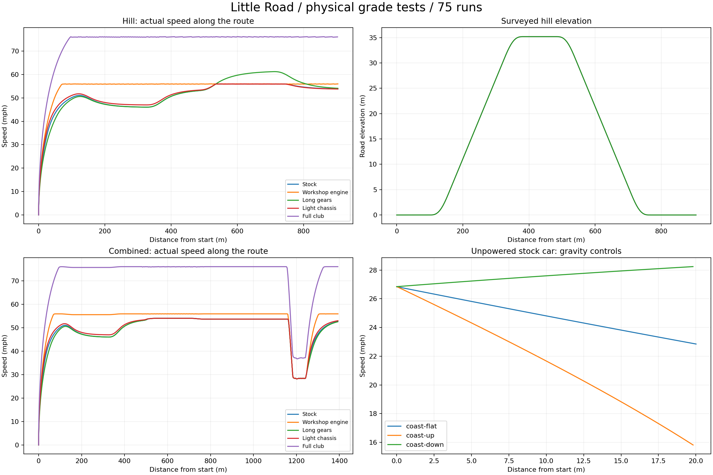

# Physical hill and coasting measurements

75 actual-car runs; **PASS**.

The hill has a 35.2 m summit, 16% sustained grades, 60 m smooth transitions and a 100 m plateau. Coasting controls start at 12 m/s and travel 20 m on the same physical support system. Gravity comes from PhysX once; the expected acceleration is gravity along the ground plus drag, with no engine or brake input.

| Course | Setup | Time (s) | Crest / final mph | Maximum local clearance (m) | Maximum alignment error (°) |
| --- | --- | ---: | ---: | ---: | ---: |
| coast-flat | stock | 1.808 | 22.85 | 0.0000 | 0.000 |
| coast-flat | engine_workshop | 1.808 | 22.85 | 0.0000 | 0.000 |
| coast-flat | transmission_long | 1.808 | 22.85 | 0.0000 | 0.000 |
| coast-flat | chassis_light | 1.833 | 22.27 | 0.0000 | 0.000 |
| coast-flat | club | 1.833 | 22.27 | 0.0000 | 0.000 |
| coast-up | stock | 2.133 | 15.66 | 0.0000 | 0.000 |
| coast-up | engine_workshop | 2.133 | 15.66 | 0.0000 | 0.000 |
| coast-up | transmission_long | 2.133 | 15.66 | 0.0000 | 0.000 |
| coast-up | chassis_light | 2.175 | 14.97 | 0.0000 | 0.000 |
| coast-up | club | 2.175 | 14.97 | 0.0000 | 0.000 |
| coast-down | stock | 1.625 | 28.25 | 0.0002 | 0.000 |
| coast-down | engine_workshop | 1.625 | 28.25 | 0.0002 | 0.000 |
| coast-down | transmission_long | 1.625 | 28.25 | 0.0002 | 0.000 |
| coast-down | chassis_light | 1.642 | 27.71 | 0.0002 | 0.000 |
| coast-down | club | 1.642 | 27.71 | 0.0002 | 0.000 |
| hill | stock | 41.658 | 49.40 | 0.0040 | 0.518 |
| hill | engine_workshop | 38.267 | 55.92 | 0.0041 | 0.496 |
| hill | transmission_long | 41.467 | 49.40 | 0.0042 | 0.516 |
| hill | chassis_light | 41.083 | 50.19 | 0.0038 | 0.478 |
| hill | club | 28.492 | 75.94 | 0.0041 | 0.478 |
| combined | stock | 66.158 | 49.40 | 0.0045 | 0.474 |
| combined | engine_workshop | 61.342 | 55.92 | 0.0043 | 0.509 |
| combined | transmission_long | 66.792 | 49.41 | 0.0038 | 0.522 |
| combined | chassis_light | 65.450 | 50.19 | 0.0041 | 0.479 |
| combined | club | 45.850 | 76.05 | 0.0042 | 0.455 |

## Checks

- PASS — Complete 75-run graded-road matrix
- PASS — Every attempted run is valid
- PASS — One runtime assembly at 120 Hz
- PASS — No contacts, recovery, missing gates or saturated support queries
- PASS — All graded runs remain physically supported: Local physical support clearance, not height above sea level; no unsupported completed physics step.
- PASS — Chassis tracks road normal within five degrees
- PASS — Every car remains within the measured carriageway
- PASS — coast-flat/stock: repeatability
- PASS — 001-coast-flat-stock-r1: matched unpowered coasting
- PASS — 001-coast-flat-stock-r1: one gravity component plus measured drag: Mean acceleration residual -0.00107 m/s²; tolerance 0.20, versus ~1.55 m/s² for one 16% grade gravity component.
- PASS — 002-coast-flat-stock-r2: matched unpowered coasting
- PASS — 002-coast-flat-stock-r2: one gravity component plus measured drag: Mean acceleration residual -0.00107 m/s²; tolerance 0.20, versus ~1.55 m/s² for one 16% grade gravity component.
- PASS — 003-coast-flat-stock-r3: matched unpowered coasting
- PASS — 003-coast-flat-stock-r3: one gravity component plus measured drag: Mean acceleration residual -0.00107 m/s²; tolerance 0.20, versus ~1.55 m/s² for one 16% grade gravity component.
- PASS — coast-flat/engine_workshop: repeatability
- PASS — 004-coast-flat-engine_workshop-r1: matched unpowered coasting
- PASS — 004-coast-flat-engine_workshop-r1: one gravity component plus measured drag: Mean acceleration residual -0.00107 m/s²; tolerance 0.20, versus ~1.55 m/s² for one 16% grade gravity component.
- PASS — 005-coast-flat-engine_workshop-r2: matched unpowered coasting
- PASS — 005-coast-flat-engine_workshop-r2: one gravity component plus measured drag: Mean acceleration residual -0.00107 m/s²; tolerance 0.20, versus ~1.55 m/s² for one 16% grade gravity component.
- PASS — 006-coast-flat-engine_workshop-r3: matched unpowered coasting
- PASS — 006-coast-flat-engine_workshop-r3: one gravity component plus measured drag: Mean acceleration residual -0.00107 m/s²; tolerance 0.20, versus ~1.55 m/s² for one 16% grade gravity component.
- PASS — coast-flat/transmission_long: repeatability
- PASS — 007-coast-flat-transmission_long-r1: matched unpowered coasting
- PASS — 007-coast-flat-transmission_long-r1: one gravity component plus measured drag: Mean acceleration residual -0.00107 m/s²; tolerance 0.20, versus ~1.55 m/s² for one 16% grade gravity component.
- PASS — 008-coast-flat-transmission_long-r2: matched unpowered coasting
- PASS — 008-coast-flat-transmission_long-r2: one gravity component plus measured drag: Mean acceleration residual -0.00107 m/s²; tolerance 0.20, versus ~1.55 m/s² for one 16% grade gravity component.
- PASS — 009-coast-flat-transmission_long-r3: matched unpowered coasting
- PASS — 009-coast-flat-transmission_long-r3: one gravity component plus measured drag: Mean acceleration residual -0.00107 m/s²; tolerance 0.20, versus ~1.55 m/s² for one 16% grade gravity component.
- PASS — coast-flat/chassis_light: repeatability
- PASS — 010-coast-flat-chassis_light-r1: matched unpowered coasting
- PASS — 010-coast-flat-chassis_light-r1: one gravity component plus measured drag: Mean acceleration residual -0.00136 m/s²; tolerance 0.20, versus ~1.55 m/s² for one 16% grade gravity component.
- PASS — 011-coast-flat-chassis_light-r2: matched unpowered coasting
- PASS — 011-coast-flat-chassis_light-r2: one gravity component plus measured drag: Mean acceleration residual -0.00136 m/s²; tolerance 0.20, versus ~1.55 m/s² for one 16% grade gravity component.
- PASS — 012-coast-flat-chassis_light-r3: matched unpowered coasting
- PASS — 012-coast-flat-chassis_light-r3: one gravity component plus measured drag: Mean acceleration residual -0.00136 m/s²; tolerance 0.20, versus ~1.55 m/s² for one 16% grade gravity component.
- PASS — coast-flat/club: repeatability
- PASS — 013-coast-flat-club-r1: matched unpowered coasting
- PASS — 013-coast-flat-club-r1: one gravity component plus measured drag: Mean acceleration residual -0.00136 m/s²; tolerance 0.20, versus ~1.55 m/s² for one 16% grade gravity component.
- PASS — 014-coast-flat-club-r2: matched unpowered coasting
- PASS — 014-coast-flat-club-r2: one gravity component plus measured drag: Mean acceleration residual -0.00136 m/s²; tolerance 0.20, versus ~1.55 m/s² for one 16% grade gravity component.
- PASS — 015-coast-flat-club-r3: matched unpowered coasting
- PASS — 015-coast-flat-club-r3: one gravity component plus measured drag: Mean acceleration residual -0.00136 m/s²; tolerance 0.20, versus ~1.55 m/s² for one 16% grade gravity component.
- PASS — coast-up/stock: repeatability
- PASS — 016-coast-up-stock-r1: matched unpowered coasting
- PASS — 016-coast-up-stock-r1: one gravity component plus measured drag: Mean acceleration residual -0.00214 m/s²; tolerance 0.20, versus ~1.55 m/s² for one 16% grade gravity component.
- PASS — 017-coast-up-stock-r2: matched unpowered coasting
- PASS — 017-coast-up-stock-r2: one gravity component plus measured drag: Mean acceleration residual -0.00214 m/s²; tolerance 0.20, versus ~1.55 m/s² for one 16% grade gravity component.
- PASS — 018-coast-up-stock-r3: matched unpowered coasting
- PASS — 018-coast-up-stock-r3: one gravity component plus measured drag: Mean acceleration residual -0.00214 m/s²; tolerance 0.20, versus ~1.55 m/s² for one 16% grade gravity component.
- PASS — coast-up/engine_workshop: repeatability
- PASS — 019-coast-up-engine_workshop-r1: matched unpowered coasting
- PASS — 019-coast-up-engine_workshop-r1: one gravity component plus measured drag: Mean acceleration residual -0.00214 m/s²; tolerance 0.20, versus ~1.55 m/s² for one 16% grade gravity component.
- PASS — 020-coast-up-engine_workshop-r2: matched unpowered coasting
- PASS — 020-coast-up-engine_workshop-r2: one gravity component plus measured drag: Mean acceleration residual -0.00214 m/s²; tolerance 0.20, versus ~1.55 m/s² for one 16% grade gravity component.
- PASS — 021-coast-up-engine_workshop-r3: matched unpowered coasting
- PASS — 021-coast-up-engine_workshop-r3: one gravity component plus measured drag: Mean acceleration residual -0.00214 m/s²; tolerance 0.20, versus ~1.55 m/s² for one 16% grade gravity component.
- PASS — coast-up/transmission_long: repeatability
- PASS — 022-coast-up-transmission_long-r1: matched unpowered coasting
- PASS — 022-coast-up-transmission_long-r1: one gravity component plus measured drag: Mean acceleration residual -0.00214 m/s²; tolerance 0.20, versus ~1.55 m/s² for one 16% grade gravity component.
- PASS — 023-coast-up-transmission_long-r2: matched unpowered coasting
- PASS — 023-coast-up-transmission_long-r2: one gravity component plus measured drag: Mean acceleration residual -0.00214 m/s²; tolerance 0.20, versus ~1.55 m/s² for one 16% grade gravity component.
- PASS — 024-coast-up-transmission_long-r3: matched unpowered coasting
- PASS — 024-coast-up-transmission_long-r3: one gravity component plus measured drag: Mean acceleration residual -0.00214 m/s²; tolerance 0.20, versus ~1.55 m/s² for one 16% grade gravity component.
- PASS — coast-up/chassis_light: repeatability
- PASS — 025-coast-up-chassis_light-r1: matched unpowered coasting
- PASS — 025-coast-up-chassis_light-r1: one gravity component plus measured drag: Mean acceleration residual -0.00254 m/s²; tolerance 0.20, versus ~1.55 m/s² for one 16% grade gravity component.
- PASS — 026-coast-up-chassis_light-r2: matched unpowered coasting
- PASS — 026-coast-up-chassis_light-r2: one gravity component plus measured drag: Mean acceleration residual -0.00254 m/s²; tolerance 0.20, versus ~1.55 m/s² for one 16% grade gravity component.
- PASS — 027-coast-up-chassis_light-r3: matched unpowered coasting
- PASS — 027-coast-up-chassis_light-r3: one gravity component plus measured drag: Mean acceleration residual -0.00254 m/s²; tolerance 0.20, versus ~1.55 m/s² for one 16% grade gravity component.
- PASS — coast-up/club: repeatability
- PASS — 028-coast-up-club-r1: matched unpowered coasting
- PASS — 028-coast-up-club-r1: one gravity component plus measured drag: Mean acceleration residual -0.00254 m/s²; tolerance 0.20, versus ~1.55 m/s² for one 16% grade gravity component.
- PASS — 029-coast-up-club-r2: matched unpowered coasting
- PASS — 029-coast-up-club-r2: one gravity component plus measured drag: Mean acceleration residual -0.00254 m/s²; tolerance 0.20, versus ~1.55 m/s² for one 16% grade gravity component.
- PASS — 030-coast-up-club-r3: matched unpowered coasting
- PASS — 030-coast-up-club-r3: one gravity component plus measured drag: Mean acceleration residual -0.00254 m/s²; tolerance 0.20, versus ~1.55 m/s² for one 16% grade gravity component.
- PASS — coast-down/stock: repeatability
- PASS — 031-coast-down-stock-r1: matched unpowered coasting
- PASS — 031-coast-down-stock-r1: one gravity component plus measured drag: Mean acceleration residual 0.00050 m/s²; tolerance 0.20, versus ~1.55 m/s² for one 16% grade gravity component.
- PASS — 032-coast-down-stock-r2: matched unpowered coasting
- PASS — 032-coast-down-stock-r2: one gravity component plus measured drag: Mean acceleration residual 0.00050 m/s²; tolerance 0.20, versus ~1.55 m/s² for one 16% grade gravity component.
- PASS — 033-coast-down-stock-r3: matched unpowered coasting
- PASS — 033-coast-down-stock-r3: one gravity component plus measured drag: Mean acceleration residual 0.00050 m/s²; tolerance 0.20, versus ~1.55 m/s² for one 16% grade gravity component.
- PASS — coast-down/engine_workshop: repeatability
- PASS — 034-coast-down-engine_workshop-r1: matched unpowered coasting
- PASS — 034-coast-down-engine_workshop-r1: one gravity component plus measured drag: Mean acceleration residual 0.00050 m/s²; tolerance 0.20, versus ~1.55 m/s² for one 16% grade gravity component.
- PASS — 035-coast-down-engine_workshop-r2: matched unpowered coasting
- PASS — 035-coast-down-engine_workshop-r2: one gravity component plus measured drag: Mean acceleration residual 0.00050 m/s²; tolerance 0.20, versus ~1.55 m/s² for one 16% grade gravity component.
- PASS — 036-coast-down-engine_workshop-r3: matched unpowered coasting
- PASS — 036-coast-down-engine_workshop-r3: one gravity component plus measured drag: Mean acceleration residual 0.00050 m/s²; tolerance 0.20, versus ~1.55 m/s² for one 16% grade gravity component.
- PASS — coast-down/transmission_long: repeatability
- PASS — 037-coast-down-transmission_long-r1: matched unpowered coasting
- PASS — 037-coast-down-transmission_long-r1: one gravity component plus measured drag: Mean acceleration residual 0.00050 m/s²; tolerance 0.20, versus ~1.55 m/s² for one 16% grade gravity component.
- PASS — 038-coast-down-transmission_long-r2: matched unpowered coasting
- PASS — 038-coast-down-transmission_long-r2: one gravity component plus measured drag: Mean acceleration residual 0.00050 m/s²; tolerance 0.20, versus ~1.55 m/s² for one 16% grade gravity component.
- PASS — 039-coast-down-transmission_long-r3: matched unpowered coasting
- PASS — 039-coast-down-transmission_long-r3: one gravity component plus measured drag: Mean acceleration residual 0.00050 m/s²; tolerance 0.20, versus ~1.55 m/s² for one 16% grade gravity component.
- PASS — coast-down/chassis_light: repeatability
- PASS — 040-coast-down-chassis_light-r1: matched unpowered coasting
- PASS — 040-coast-down-chassis_light-r1: one gravity component plus measured drag: Mean acceleration residual 0.00031 m/s²; tolerance 0.20, versus ~1.55 m/s² for one 16% grade gravity component.
- PASS — 041-coast-down-chassis_light-r2: matched unpowered coasting
- PASS — 041-coast-down-chassis_light-r2: one gravity component plus measured drag: Mean acceleration residual 0.00031 m/s²; tolerance 0.20, versus ~1.55 m/s² for one 16% grade gravity component.
- PASS — 042-coast-down-chassis_light-r3: matched unpowered coasting
- PASS — 042-coast-down-chassis_light-r3: one gravity component plus measured drag: Mean acceleration residual 0.00031 m/s²; tolerance 0.20, versus ~1.55 m/s² for one 16% grade gravity component.
- PASS — coast-down/club: repeatability
- PASS — 043-coast-down-club-r1: matched unpowered coasting
- PASS — 043-coast-down-club-r1: one gravity component plus measured drag: Mean acceleration residual 0.00031 m/s²; tolerance 0.20, versus ~1.55 m/s² for one 16% grade gravity component.
- PASS — 044-coast-down-club-r2: matched unpowered coasting
- PASS — 044-coast-down-club-r2: one gravity component plus measured drag: Mean acceleration residual 0.00031 m/s²; tolerance 0.20, versus ~1.55 m/s² for one 16% grade gravity component.
- PASS — 045-coast-down-club-r3: matched unpowered coasting
- PASS — 045-coast-down-club-r3: one gravity component plus measured drag: Mean acceleration residual 0.00031 m/s²; tolerance 0.20, versus ~1.55 m/s² for one 16% grade gravity component.
- PASS — hill/stock: repeatability
- PASS — hill/stock: surveyed summit reached and descent completed
- PASS — hill/engine_workshop: repeatability
- PASS — hill/engine_workshop: surveyed summit reached and descent completed
- PASS — hill/transmission_long: repeatability
- PASS — hill/transmission_long: surveyed summit reached and descent completed
- PASS — hill/chassis_light: repeatability
- PASS — hill/chassis_light: surveyed summit reached and descent completed
- PASS — hill/club: repeatability
- PASS — hill/club: surveyed summit reached and descent completed
- PASS — combined/stock: repeatability
- PASS — combined/stock: surveyed summit reached and descent completed
- PASS — combined/engine_workshop: repeatability
- PASS — combined/engine_workshop: surveyed summit reached and descent completed
- PASS — combined/transmission_long: repeatability
- PASS — combined/transmission_long: surveyed summit reached and descent completed
- PASS — combined/chassis_light: repeatability
- PASS — combined/chassis_light: surveyed summit reached and descent completed
- PASS — combined/club: repeatability
- PASS — combined/club: surveyed summit reached and descent completed
- PASS — stock: downhill coast faster than flat, flat faster than uphill
- PASS — engine_workshop: downhill coast faster than flat, flat faster than uphill
- PASS — transmission_long: downhill coast faster than flat, flat faster than uphill
- PASS — chassis_light: downhill coast faster than flat, flat faster than uphill
- PASS — club: downhill coast faster than flat, flat faster than uphill
- PASS — coast-flat: unfuelled engine upgrade cannot propel a coasting car
- PASS — coast-up: unfuelled engine upgrade cannot propel a coasting car
- PASS — coast-down: unfuelled engine upgrade cannot propel a coasting car
- PASS — hill: workshop engine improves climb time
- PASS — hill: lighter chassis improves powered climb time
- PASS — hill: full club setup improves total time
- PASS — combined: workshop engine improves climb time
- PASS — combined: lighter chassis improves powered climb time
- PASS — combined: full club setup improves total time
- PASS — Club car sheds downhill overspeed on the flat exit: The engine must not cancel drag indefinitely above its gear ceiling after gravity has accelerated the car downhill.

## Limits

Actual car on dry surveyed hill/combined/coasting fixtures; not campaign track, fuel, wet/off-road, natural AI or human acceptance.
Ground support aligns an aggregate car collider with sampled collision geometry through torque. It is not a wheel suspension or tyre slip-ratio simulation. Do not infer banked-road, airborne jump, mixed traffic on hills or production-controller acceptance from these isolated runs. Retain the flat equipment and 24-car Bayview vertical regressions before promoting a build.

