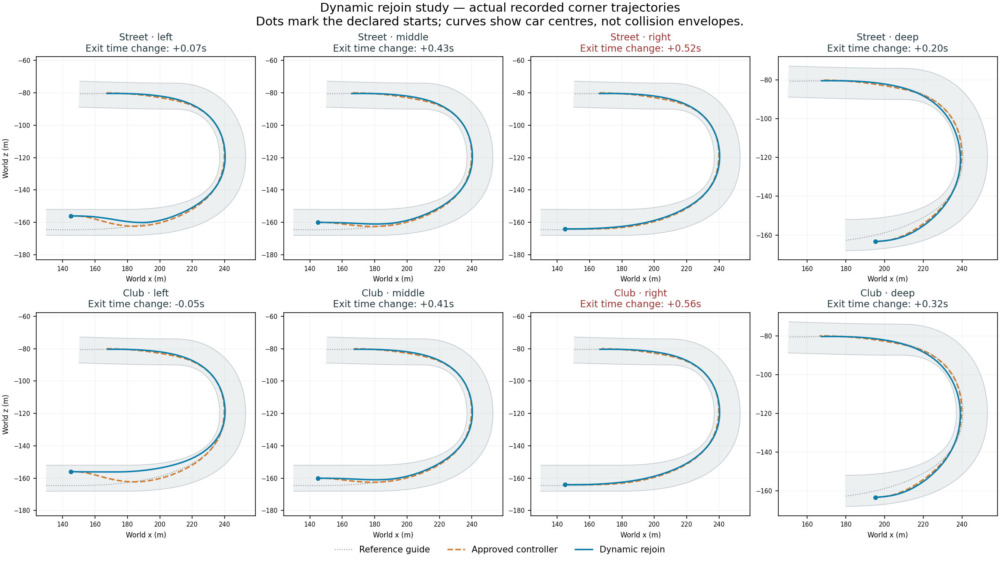

# Prototype74: solo dynamic rejoin experiment

23 September 2026. **Foundation implemented; pace acceptance failed; not promoted.** The approved behavioural reference remains71. Desktop prototype shortcut55 and the adventure build are unchanged.

## Implementation and verification

`--dynamic-rejoin` is restricted to solo context trials with physical road checks. Five guide-relative quintic curves begin at observed position/lateral motion and meet the guide at different future distances. A sixth candidate retains the previous curve when eligible. Candidate speed envelopes use existing equipment, curvature, braking and steering limits. A cheap time estimate to a common120m gate ranks candidates; only the top two receive existing physical feasibility checks. The estimate is not a physical proof, especially for an initially overspeed state. No equipment, force, grip or car0 advantage was added.

454 build checks pass. The disabled24-car run exactly matches71's enabled open-space reference motion, events, sampled contexts and results. New path speed state participates in forecast identity and survives committed-path continuation. Warm allocation and live/forecast consistency checks are included. Compiled sources remain frozen in `source-74`; the manifest records the assembly and a separate validation-tool supplement.

The matrix contains street/club equipment, left/middle/right/deep entries and paired disabled/enabled runs:16 total. Entry speed is20m/s. Deep entry is a later declared start, not a captured human overshoot. All16 finish, earn the relevant checkpoint, and record zero contacts, body departures, physical recoveries, unresolved selections and measured warm driver allocation. Every enabled case exercises the planner. No runtime errors were found.

## Pace results

Corner passage is interpolated from10Hz actual progress samples at a common449.441m gate, backed by the physical checkpoint crossing. Positive deltas below are slower. Remaining-course finish times are not full rear-grid race laps.

| Equipment / entry | Corner delta | Remaining course off | Remaining course on |
|---|---:|---:|---:|
| Street / left | +0.070s | 76.412s | 76.153s |
| Street / middle | +0.425s | 75.995s | 76.054s |
| Street / right | +0.523s | 75.904s | 76.120s |
| Street / deep | +0.203s | 74.421s | 74.346s |
| Club / left | -0.054s | 60.672s | 60.131s |
| Club / middle | +0.406s | 60.172s | 60.014s |
| Club / right | +0.562s | 59.964s | 60.131s |
| Club / deep | +0.323s | 58.839s | 58.780s |

The median paired corner delta is **+0.364660s**. Median gate time increases8.062298→8.238505s, and street-right/club-right exceed the predeclared0.5s individual loss limit. Overall analysis therefore returns `passed:false`. Five remaining-course times improve, but this does not override the corner failures. Tiny differences should not be overinterpreted given10Hz sampling and this small deterministic fixture set.

The paths demonstrate different approaches and subsequent convergence towards the guide, rather than unrestricted corner/apex choices. Hidden solo mean AI cost is approximately0.164–0.172ms enabled versus0.178–0.182ms disabled. These changed-workload solo timings do not establish24-car performance or rendered smoothness. Existing field frame budgets still apply.

## Next bounded change

The ordinary entry starts at244.999939m,204.44m before the scoring exit; deep entry starts at294.999939m,154.44m before it. Ranking covers120m, and a fresh rejoin curve ends within110m. At the ordinary initial state, the planner cannot compare a route staying off the guide through the full corner and exit. This is a concrete limitation, not a demonstrated sole cause of the observed pace losses.

Use a common corner-aware endpoint beyond the exit and allow later rejoining. Keep sample/candidate counts and the physical shortlist bounded. Before scaling to traffic, compare predicted candidate times with actual executed witness curves and test ranking quality, exit speed, road containment, continuity and stopping feasibility. Avoid tuning the existing five scales merely to win this batch. No additional build was started after this review.

## Evidence

- `dynamic-rejoin-74-expectations.md`: predeclared experiment contract.
- `dynamic-rejoin-74/analysis.json`: per-case metrics and failed acceptance checks.
- `dynamic-rejoin-74/field-off/motion-parity.json`: disabled field parity.
- `dynamic-rejoin-74/*/`: raw runs and launch/exit records.
- `build-context-74.log`, `build-context-74-checks.json`, `prototype-74-manifest.json`: build and provenance.
- `validation-tools-74/`: frozen runner, analysis, plotting and supporting tools.

This solo slice does not close71's no-room regression, validate dynamic traffic, meet the80-second target, implement personalities or satisfy the full game goal.
