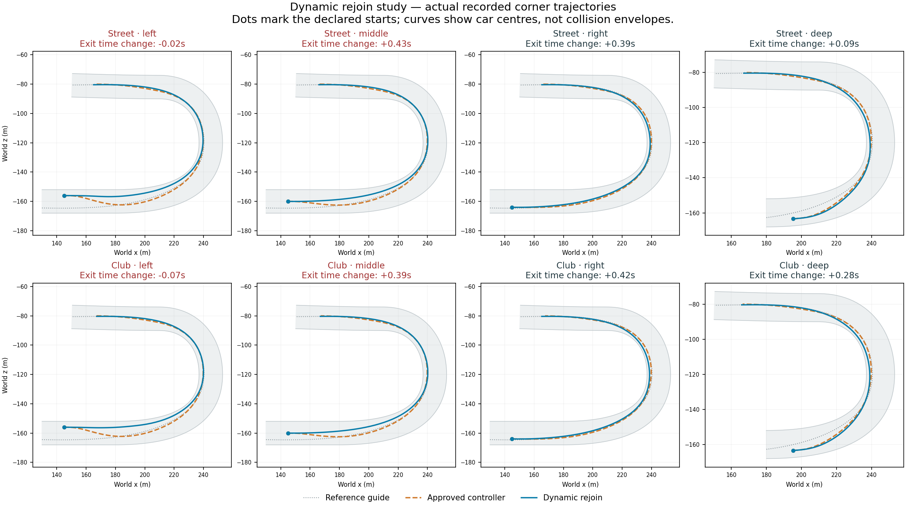

# Prototype75: corner-aware planning horizon

23 September 2026. **Implemented and measured; not promoted.** Seven of eight corner results improve over74, but the runtime pace criterion still fails and four fixtures introduce unresolved planning.71 remains the user-liked racing reference. No desktop shortcut or adventure build changed.

## Change and provenance

The solo planner now detects the next corner/complex from shared guide curvature and compares to a gate beyond its exit, bounded120–360m. Fresh curves can rejoin through or after the exit, rather than necessarily within110m. Five curves plus a current continuation remain the maximum; only two shortlisted curves receive the existing physical forecast. Ranking samples at approximately3m spacing, at most121 points. The live/forecast controller remains41points over120m. No new physics, equipment advantage, traffic mode or weaker collision margin.

Build75 passes456 checks. Disabling the feature gives exact71 field motion/events/results parity. Compiled sources and assembly are frozen in `source-75` and `prototype-75-manifest.json`; later validation scripts are archived separately. The experiment contract was recorded in `dynamic-rejoin-75-expectations.md` before running.

## Fixed-curve witness study

40 complete-gate executions in the shared planar vehicle model cover five initial proposals, four entries and two loadouts. Initial gates are252m ahead for ordinary entries and204m for deep entries, beyond the measured corner exit. Every selected initial curve is contained and within0.034s of the fastest contained witness, meeting the declared0.25s ranking allowance. Rejected longer curves in left/middle entries also leave the road in this model.

Absolute estimates remain optimistic: per-fixture median errors range approximately-0.72 to-1.08s. This is relative ranking evidence, not calibrated predicted lap time. Witnesses use a declared half-width1.2m/half-length2.3m and flat-road model, without traffic, Rigidbody contacts or replanning; the runtime uses the actual generated collider (the captured street car is approximately1.16m/1.588m). These are not identical runtime witnesses. Raw40 executions and analysis: `dynamic-rejoin-75-witness.json` and `dynamic-rejoin-75-witness-analysis.json`.

## Runtime results

All16 off/on runs finish, earn the corner checkpoint, and record zero contacts, body departures, physical recoveries, runtime errors and measured warm driver allocations. Remaining-course times are not full rear-grid laps. Positive corner deltas below are slower than the unchanged reference controller.

| Equipment / entry | Corner delta | Change versus74 corner | Remaining course off → on | Unresolved samples on |
|---|---:|---:|---:|---:|
| Street / left | -0.020s | -0.090s | 76.412 → 76.070s | 23 |
| Street / middle | +0.433s | +0.008s | 75.995 → 76.054s | 2 |
| Street / right | +0.387s | -0.137s | 75.904 → 75.962s | 0 |
| Street / deep | +0.092s | -0.111s | 74.421 → 74.104s | 0 |
| Club / left | -0.072s | -0.018s | 60.672 → 60.097s | 4 |
| Club / middle | +0.387s | -0.019s | 60.172 → 60.039s | 1 |
| Club / right | +0.420s | -0.143s | 59.964 → 59.872s | 0 |
| Club / deep | +0.277s | -0.046s | 58.839 → 58.614s | 0 |

Median paired corner loss is **0.331828s** versus74's0.364660s. The median of enabled gate times also fails to improve. No individual loss now exceeds0.5s, but four fixtures fail the no-new-unresolved requirement (all disabled runs have zero). The median paired change against74 is-0.068062s; tiny differences should not be overinterpreted with10Hz gate interpolation. These gains do not override failures.

Hidden solo mean AI cost is approximately0.210–0.228ms enabled versus0.196–0.227ms disabled. The disabled field measured4.613ms versus the earlier71 capture's3.627ms, despite exact motion parity. Timing has not established a performance gain; machine/workload variation and the larger scratch buffers need controlled investigation before promotion. No rendered or24-car dynamic performance acceptance is claimed.

## Captured failure and next action

The street-left diagnostic replay exactly preserves the original run's motion, events and results. It captures23 failed selections,42 checked-candidate rejections, all for predicted road containment, with no dropped audit entries. First failure: route284.5636m, speed24.8846m/s, offset-3.5418m, yaw rate-0.17792rad/s, steering-0.17856. The two checked168m-blend paths predict road bounds7.9993m and8.1215m against the7.9m allowance, first uncertain at1.95s and1.7667s respectively. This is forecast evidence, not an actual departure or proof that every alternative was impossible.

`street-left-audit/failure-analysis.json` retains this exact observation, candidate states and seven opening captures with the previous committed curve. The starting-state witness success therefore does not transfer automatically to later moving states. The old path is retained on failure without a safety claim; that behavior remains unresolved.

**Next bounded task:** replay these captured moving states and evaluate all six candidate curves diagnostically, including continued geometry and actual collider/steering/yaw state. Determine whether the shortlist excludes a viable curve, whether curve construction cannot represent an executable rejoin, or whether speed/tracking prediction is miscalibrated. Then change the responsible layer; preserve bounded live work. Do not increase the live rollout budget blindly, weaken road margins, or substitute successful initial witnesses for these failures. The curve family still only varies guide rejoin distance; independent apex/exit waypoints and traffic-aware dynamic paths remain future work.

The80-second target,71 no-room regression, rendered performance, personalities, adventure integration and full campaign remain open. No new build was started after this diagnosis.

## Evidence locations

- `dynamic-rejoin-75/analysis.json`:16-run metrics and failed acceptance.
- `dynamic-rejoin-75/comparison-to-74.json`:paired previous-experiment changes.
- `dynamic-rejoin-75/field-off/motion-parity.json`:disabled71 parity.
- `dynamic-rejoin-75/street-left-audit/`:exact diagnostic replay, parity and captured failures.
- `build-context-75.log`, `build-context-75-checks.json`, `prototype-75-manifest.json`, `validation-tools-75/`:build/provenance/tools.

Provenance follow-up during76: the inherited witness writer regenerated the75 raw witness filename. The preserved75 summary exactly matches the regenerated result; see76 witness provenance and review. The reporting-only defect is corrected for subsequent runs, and runtime trial data and frozen archives remain unchanged.
