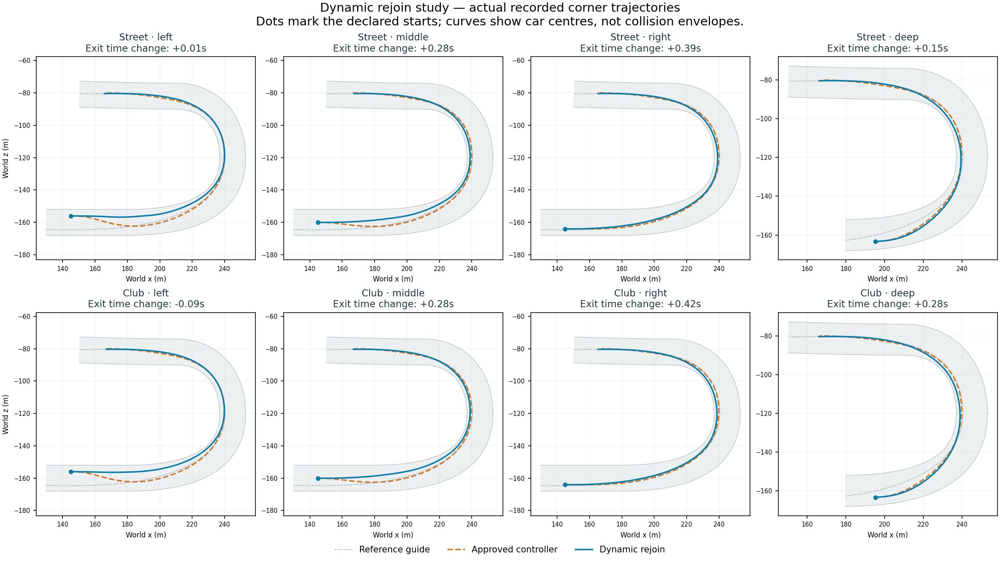

# Prototype76: a usable second physical check

23 September 2026. **The observed shortlist failure is fixed in this matrix; dynamic corner pace still fails acceptance.**71 remains the user-liked racing reference.76 is a solo study, not a promoted field/adventure build. Desktop shortcuts remain unchanged.

## Diagnosis and change

The moving-state replay exactly reproduces42/42 candidate forecasts from75, including recorded position, velocity, heading, road bound and rejection. At six of seven captured unresolved opening states, an existing lower-ranked curve passes both the two-second road forecast and a complete-gate fixed-curve model execution. The old top-two shortlist misses all six. At the final state, no existing curve is contained.

76 still physically checks the fastest ranked proposal first. Only when that fails, the second check uses the finite-score alternative with greatest minimum sampled geometric body clearance, preserving time order for ties within1mm. Clearance is accumulated during existing cheap time-ranking traversal, without an extra sampling pass or warm allocation. It is a diversity signal, not a safety certificate. The normal physical check decides acceptance; the limit remains two rollouts. Physics, equipment, road allowance, ranking horizon and curve family are unchanged.

The new fallback selects a contained curve in all six recoverable captures, including complete-gate model execution. It offers no finite alternative in the exhausted seventh state. These are captured-state/model results, not general collision guarantees.

## Runtime validation

456 build checks pass. Disabling dynamic rejoining preserves exact71 field motion, samples, events and results. All16 paired solo runs finish and earn the corner checkpoint with zero contacts, body departures, physical recoveries, unresolved selections, runtime errors and measured warm driver allocations. All individual fixture checks pass; global median pace does not.

| Equipment / entry | Corner delta versus reference | Remaining course off → on | Unresolved75 →76 |
|---|---:|---:|---:|
| Street / left | +0.007s | 76.412 →76.054s | 23 →0 |
| Street / middle | +0.283s | 75.995 →75.962s | 2 →0 |
| Street / right | +0.387s | 75.904 →75.962s | 0 →0 |
| Street / deep | +0.154s | 74.421 →74.146s | 0 →0 |
| Club / left | -0.086s | 60.672 →60.047s | 4 →0 |
| Club / middle | +0.281s | 60.172 →59.881s | 1 →0 |
| Club / right | +0.420s | 59.964 →59.889s | 0 →0 |
| Club / deep | +0.277s | 58.839 →58.614s | 0 →0 |

Median paired corner loss is **0.278872s**, down from75's0.331828s; enabled/disabled median gate times are8.159654/8.062298s. Every loss is below0.5s, but only one corner case is faster than the reference. Seven remaining-course times improve; these are not rear-grid race laps and do not override the corner criterion. `analysis.json` correctly remains `passed:false` despite an empty individual-case failure list.

Hidden solo mean AI costs span0.177–0.214ms enabled and0.176–0.218ms disabled. The disabled field measured4.427ms versus71's earlier3.627ms. Exact motion parity does not prove timing parity; no performance gain or rendered acceptance is claimed. Dynamic24-car scaling remains untested.

## Remaining pace and next action

In the street-middle trace, the dynamic driver is0.181s ahead at100m beyond entry, but0.283s behind at the204.44m exit. At125m/150m, speeds are approximately17.03/15.23m/s versus20.98/17.95m/s for the reference. It runs closer to the inside edge (sampled centre offsets around-6m versus-5m), then exits at a similar speed. This identifies the middle of the bend as a useful next test; it does not prove whether geometry, tracking or speed control causes the loss.

**Next:** inspect committed geometry and same-tick control stages through that bend. Compare commanded curve versus actual travel, curvature-derived limits, braking/acceleration feed-forward and reference geometry reconstruction. Establish whether the car follows an unnecessarily tight path, tracks a good path poorly, or limits speed unnecessarily. Then change the responsible layer. This curve family only varies rejoin distance and cannot independently choose an apex/exit waypoint; extend it where evidence calls for that freedom. Preserve the captured-state regression and two-rollout budget.

71's separate no-room regression, the80-second target, rendered performance, personalities, adventure integration and the full campaign remain open. No new racing build was started after this review.

## Evidence and reporting correction

- `dynamic-moving-state-75.json`:original exact replay and all-candidate executions; original replay source in `moving-replay-source-75/`.
- `dynamic-moving-state-76.json` and `-analysis.json`:fallback replay and recoverable/exhausted distinction.
- `dynamic-rejoin-76/analysis.json`, `field-off/motion-parity.json`, raw run folders, `street-middle-pace-sectors.json`:runtime acceptance and pace evidence.
- `dynamic-rejoin-76-witness.json`, `-analysis.json`, `-provenance.json`:initial fixed-curve witness repeat and provenance.
- `build-context-76.log`, `build-context-76-checks.json`, `source-76`, `prototype-76-manifest.json`, `validation-tools-76/`:compiled inputs, assembly identity and later tools.

The inherited editor witness used a hardcoded75 filename and regenerated that raw file during build76. Its new summary exactly matches the preserved75 summary; no runtime trial or frozen source archive was overwritten. The regenerated raw output was copied to76 and the limitation recorded. A subsequent editor-only correction derives the report version from `--review-export` or an explicit output argument and refuses to overwrite versioned reports. Unversioned checks use a designated current report. The correction compiled and executed into `dynamic-rejoin-76-reporting-check.json`, with data equal to76's witness. It is archived as a post-build reporting fix; frozen76 inputs remain unchanged.
