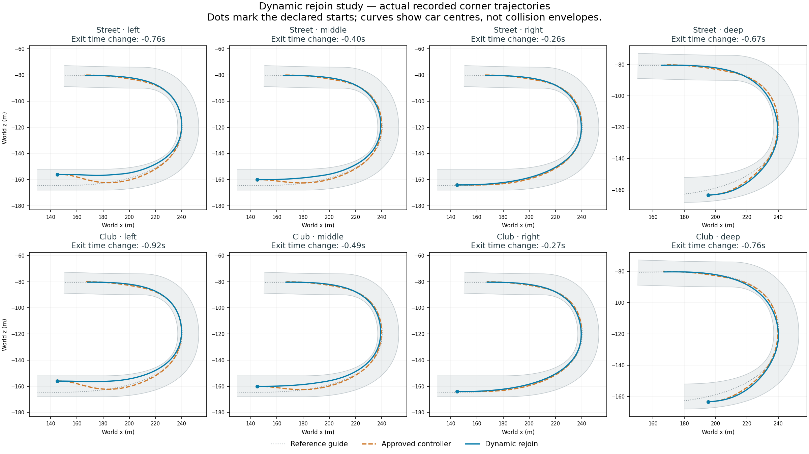

# Prototype 77: dynamic rejoining passes the solo pace screen

23 September 2026. The local speed-envelope correction improves every paired corner case at both declared entry speeds. This is a successful solo milestone, not a promoted 24-car/adventure build. 71 remains the user-liked racing reference; desktop prototype 55 remains unchanged.

## Cause and correction

Exact unchanged-76 diagnostic runs reproduce their original motion. Offline replay matches all five overlapping same-tick pedal/target samples in each mode. The local envelope left point 0 at the equipment maximum while applying curvature limits from point 1 onwards. Backward braking propagation therefore manufactured an almost constant maximum-braking gradient between those first two points, even when the car was below its target speed.

At route 367.585 m, the old dynamic driver travels at 16.869 m/s against a 21.216 m/s target. Feed-forward of -11.1375 m/s² cancels much of the +13.042 speed feedback and +1.957 drag compensation, leaving roughly 49% throttle. Tracking error there is only about 0.012 m; the deficit cannot be attributed solely to failing to follow the chosen curve.

The opt-in `--local-origin-curvature` caps point 0 using the first measured segment curvature before backward propagation. Later curvature limits, braking capability, normal steering, physics, equipment and coasting checks remain intact. Live and forecast followers share the correction. There is no pace bonus or increased physical-rollout budget.

The corrected street-middle trace exactly preserves its non-diagnostic 77 run. Its offline replay again matches all five overlapping same-tick commands. Across the inspected middle-of-corner observations, the artificial -11.1375 term is replaced by zero where the adjacent curvature caps are equal. Actual speed now tracks the target more closely. These are different executed trajectories/timestamps, not a matched-state causal speed comparison. Dedicated fixed-state checks isolate the control change and retain braking for a genuinely tighter upcoming path.

## Validation

461 build checks pass, including five focused checks for origin control, real braking demand, unchanged legacy behavior, live/forecast agreement and warm allocation. Correction-disabled dynamic motion/events/results exactly match 76. All 32 primary/robustness runs finish and earn the corner checkpoint, with zero contacts, body departures, physical recoveries, unresolved selections, runtime errors and measured warm driver allocation.

| Equipment / entry | Corner change at 20 m/s | Corner change at 25 m/s | Remaining course at 20 m/s, reference → dynamic |
|---|---:|---:|---:|
| street-left | -0.765s | -0.606s | 76.412 → 73.987s |
| street-middle | -0.397s | -0.350s | 75.995 → 73.954s |
| street-right | -0.264s | -0.275s | 75.904 → 73.954s |
| street-deep | -0.670s | -0.648s | 74.421 → 72.013s |
| club-left | -0.918s | -0.975s | 60.672 → 57.680s |
| club-middle | -0.488s | -0.494s | 60.172 → 57.672s |
| club-right | -0.269s | -0.286s | 59.964 → 57.597s |
| club-deep | -0.762s | -0.735s | 58.839 → 56.021s |

Median paired corner changes are **-0.579 s** at 20 m/s and **-0.550 s** at 25 m/s. Every individual case improves. Remaining-course gains range from approximately 1.95 to 3.02 seconds across the two batches. These are solo runs starting partway around Cedar, not full rear-grid race laps or evidence that the 80-second target is achieved.

Enabled hidden solo mean AI costs span approximately 0.175–0.224 ms per snapshot across the two batches. This is not rendered-frame acceptance or proof of 24-car scaling.

## Disabled field parity and evidence limits

The raw 71-versus-77 field parity report fails only the motion-array check: 71 has 2,424 rows and 77 has 2,400. The common 2,400 rows are exact; all 24 excess rows occur at 100.005989 s, after the final finish at 99.956001 s. Race-active motion, checkpoints, impacts, assists, overlap events, samples, context samples and car results match exactly. The original failed raw report is retained alongside a narrowly scoped terminal-tail explanation. This is not claimed as full raw-array parity.

The disabled field's hidden mean AI cost is 3.964 ms versus the earlier 71 measurement of 3.627 ms; no field performance improvement is claimed. Build-time `dynamic-rejoin-77-witness.json` ran with the new correction disabled and must not be used as corrected-77 evidence. Acceptance rests on the actual paired runtime matrices, command replay and focused checks.

## Next bounded milestone

Introduce traffic-aware dynamic paths in controlled two- and three-car encounters before expanding to the 24-car field. Preserve this solo suite as a regression. Define success before running: legitimate passes with an equipment advantage, no unnecessary response to a car wholly behind, no departure/recovery or new unresolved selection, and competitive gate time. Validate opponent swept-body checks on the chosen continuous trajectory, not a permanent lane label. Then measure collective field time, preview time/position, contacts and rendered frame costs against 71 on the unchanged grid/loadouts.

The separate 71 no-room regression, 80-second target, full-field performance, personalities, adventure integration and full campaign remain open. No shortcut or adventure promotion was made.

## Reproduction and archive

- `dynamic-rejoin-77-expectations.md`: declared change and primary/robustness criteria before their runs.
- `dynamic-rejoin-77/analysis.json` and `dynamic-rejoin-77-faster/analysis.json`: complete paired matrices and raw run folders.
- `dynamic-rejoin-76/street-middle-trace-{off,on}/control-replay.json`: original attribution; exact diagnostic parity retained beside each.
- `dynamic-rejoin-77/street-middle-trace-on/control-replay.json`: corrected command replay and exact runtime parity.
- `dynamic-rejoin-77/street-middle-origin-off/motion-parity.json`: correction-disabled equivalence.
- `dynamic-rejoin-77/field-off/{motion-parity,terminal-motion-tail}.json`: raw mismatch and narrow explanation.
- `build-context-77.log`, `build-context-77-checks.json`, `source-77/`, `prototype-77-manifest.json`, `validation-tools-77/`: compiled inputs, checks, assembly identity and validation tooling.
