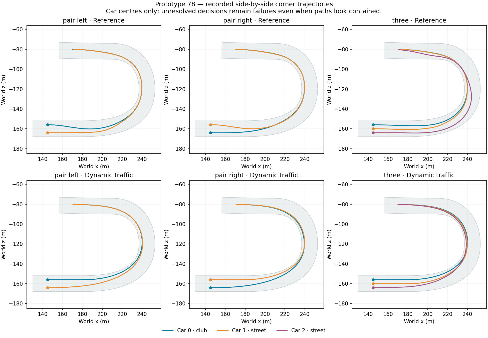

# Prototype 78: quicker traffic paths, not accepted

23 September 2026. Previous goal turn made progress by validating 77 solo pace. This milestone integrates continuous local trajectory/speed selection into two- and three-car fixtures. Every paired collective gate and remaining-course time improves, but new unresolved decisions and narrow-road contacts prevent promotion. **No 24-car dynamic run has occurred.** 71 remains the user-liked field reference; desktop prototype 55 and adventure checkpoint 20 remain unchanged. The complete campaign goal remains active.

## Change and validation

The opt-in traffic planner compares six curves: the previous local curve (or a fresh motion-based hold if none exists), a corner-aware guide return, and two approach lengths on each side of the closest forward/adjacent opponent. Targets are continuous body-relative offsets, not permanent lanes. Clear track preserves 77's rejoin family. This remains a restricted curve family, not arbitrary apex optimization.

Common-gate timing includes estimated forward-traffic delay on the actual curve during a bounded three-second observed-motion window. Wholly trailing cars cannot create a reward for yielding. This approximation is not collision certification. Existing physical road/scenery checks, moving side-entry sweeps, adjacent/merge bounds, leader limits and immediate safety remain authoritative. Two nominal physical checks remain, plus existing bounded coast/following fallbacks. Dynamic selection replaces legacy continuation comparisons. No power, grip, body or risk adjustment was made.

465 build checks pass. New checks cover continuity/passing sides, forward-traffic timing, absence of a rear-yield timing incentive, and zero warm allocation. Traffic-disabled solo motion/events/results exactly reproduce 77. Each side of the eight-case matrix completes all 18 entrants, with zero road departures, physical recoveries, runtime errors and measured warm driver allocations. All corner checkpoints are earned.

| Fixture | Combined exit delta | Combined remaining-course seconds, reference → dynamic | Unresolved samples, reference → dynamic | Dynamic contact reports |
|---|---:|---:|---:|---:|
| Pass | -0.062s | 61.058 → 60.700 | 4 → 0 | 0 |
| Queue | -0.198s | 94.633 → 94.000 | 3 → 2 | 0 |
| Corner pair left | -1.239s | 136.692 → 131.776 | 4 → 8 | 0 |
| Corner pair right | -0.640s | 135.976 → 131.551 | 2 → 17 | 0 |
| Corner three | -1.678s | 213.637 → 206.546 | 5 → 16 | 0 |
| Rear control left | -0.101s | 52.441 → 52.116 | 0 → 0 | 0 |
| Rear control right | -0.107s | 52.441 → 52.108 | 0 → 0 | 0 |
| No room | -0.073s | 66.375 → 62.150 | 0 → 47 | 5 |

Median exit gain per entrant is 0.0661 seconds across the seven open-road cases. Remaining-course gains include 77's clear-track improvement; do not attribute them entirely to overtaking. These are declared mid-lap fixtures, not full rear-grid races or evidence of the 80-second target.

The predeclared sustained-pass-by-exit criterion fails for pass and queue. In pass, body clearance occurs at 5.342s, the preview exits at 7.114s, and two-second confirmation arrives at 7.342s. In queue, the second opponent is body-cleared at 7.583s, after the preview exits at 6.999s; confirmation arrives at 9.583s. Preserve these failures. A future fixture may separate physical-clearance and confirmation deadlines, with criteria declared before rerunning.

The no-room case records five contacts with `Narrow passing control` scenery, not five independently deduplicated collisions. No pass occurs inside its scored corridor. Faster completion does not compensate for the new defect. An earlier commentary called the batch contact-free before inspecting this final case; that statement was explicitly corrected.

Both rear-control leaders exit about 0.050s sooner, passing that timing screen. This does not prove every trailing-car interaction. Hidden enabled mean all-AI costs span roughly 0.357–0.682ms per snapshot versus 0.217–0.455ms disabled. Several cases cost considerably more. Dynamic forecasts remain synchronous; no rendered/scaling acceptance is claimed.

## Exact diagnosis

An instrumented repeat of corner-pair-left preserves all recorded motion/events/results. A post-build editor replay reproduces **16/16 original nominal checks** at eight failed observations, including captured bodies, tuning, steering, traffic, corridor bounds, rejection reasons and forecast states.

Failed-plan captures omit the previous path. Counterfactual generation therefore deliberately starts without a continuation; this is not claimed to reconstruct the original full candidate set. At six early car-1 failures, a fresh motion-based hold passes the short physical/traffic/corridor check; guide-return and passing alternatives fail the adjacent-car corridor. The runtime family omits that fresh hold whenever a prior curve exists. This identifies a missing fallback option. A passing short forecast does not prove a complete manoeuvre.

At two later car-0 failures, every fresh candidate fails the corridor check. The fresh hold is not a universal fix, and blanket relaxation of rear reservations is not justified. The no-room scenery failure needs separate scene-aware diagnosis.

The first editor replay correctly failed because the opening audit covers car 0 and sampled no failed decisions. Its log is retained. Using the all-driver failure captures produced the exact replay. Only editor diagnostic code was added after the frozen player build.

## Next work and milestone review

Include a freshly anchored hold alongside retained/guide/passing curves within a bounded budget. Validate the six captured states, then rerun traffic. Investigate the other corridor failures separately and capture the narrow-road decisions with actual scenery. Measure CPU cost and preserve solo behavior before comparing an unchanged 24-car grid against 71 for total time, preview lap/position, incidents and rendered frame costs.

Race behavior improves in pace but fails acceptance. Recorded trajectory plots were inspected; there was no moving rendered/player acceptance this turn. Performance has zero warm allocation but increased CPU cost. Progression, exploration, UI, physical controller and save acceptance have no new evidence this turn. Production readiness remains an opt-in experiment. Personalities, adventure integration, prior regressions and the full campaign remain open.

Evidence: `dynamic-traffic-78-expectations.md`, paired raw folders and `analysis.json`, `solo-parity/motion-parity.json`, `corner-pair-left-audit/motion-parity.json`, `corner-pair-left-audit/candidate-replay.json`, both replay logs, build checks/log, `source-78/`, `prototype-78-manifest.json`, and `validation-tools-78/`. The post-build editor replay is archived separately from player inputs.
