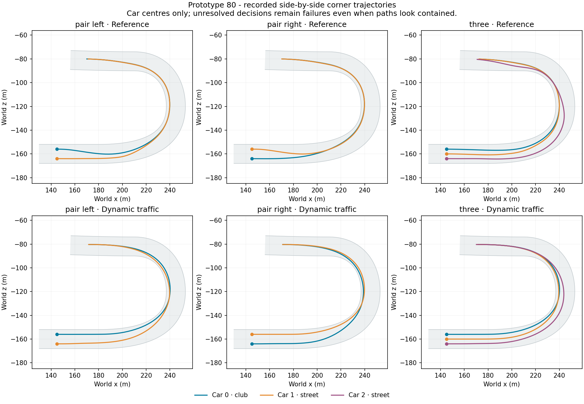

# Prototype 80: controlled traffic integrity improves

23 September 2026. Previous goal turn made progress on the first traffic integration; this turn delivered and measured 79 and 80. The current controlled matrix retains every collective pace gain, has no contact/departure/recovery, and reduces enabled unresolved samples to one across eight fixtures. Strict pass-confirmation deadlines still fail, so `analysis.json` correctly remains failed. This supports an **exploratory 24-car experiment**, not production promotion. No full-field dynamic timing exists yet. Desktop prototype 55 and adventure checkpoint 20 remain unchanged.

## Changes and evidence

79 added the fresh hold and checked-guide scenery fallback; see [its retained review](dynamic-traffic-79-review.md). 80 bounds tactical adjacency by wrapped route distance before physical longitudinal projection. The broad neighbourhood is a road width plus both longitudinal half-extents. This prevents cars on separate circuit sections from claiming alongside space, while world-space collision sweeps remain unchanged. The rule is enabled only for dynamic traffic and shared by preference maps and candidate generation.

Two captured 78 failures had opponents 160.210 and 167.112 metres behind on another Cedar section, but world projection falsely made them adjacent and excluded the current car pose at time zero. Five new build checks exercise those route/offset witnesses, genuine corner adjacency, lap-wrap adjacency and a nearby closing rear car's merge reservation. The witnesses reconstruct geometry from recorded route/offset, not exact captured body poses.

80 also spends its second nominal check on the fresh hold after a corridor rejection. Scenery rejections retain 79's guide fallback; road rejections retain clearance-based fallback. All choices still require physical checks. Six candidates, two nominal checks and bounded existing fallback checks remain; vehicle physics, equipment, body bounds and risk are unchanged.

473 build checks pass. All eight disabled pairs exactly match 79 motion/events/results, and solo behavior exactly matches 77. No field or rendered acceptance is inferred from those checks.

## Controlled runtime matrix

Each side completes all 18 entrants over eight declared mid-lap fixtures. All corner checkpoints are earned. No contacts, road departures, physical recoveries, runtime errors or measured warm driver allocations occur. Only one enabled unresolved sample remains, in the three-car corner; the reference has five in that case. All individual checks pass except the two strict passing deadlines.

| Fixture | Combined gate change vs reference | Combined remaining course, reference → 80 (s) | Unresolved 79 → 80 |
|---|---:|---:|---:|
| pass | -0.062s | 61.058 → 60.700 | 0 → 0 |
| queue | -0.198s | 94.633 → 93.983 | 0 → 0 |
| corner-pair-left | -1.393s | 136.692 → 131.617 | 4 → 0 |
| corner-pair-right | -0.642s | 135.976 → 131.551 | 11 → 0 |
| corner-three | -1.583s | 213.637 → 206.405 | 25 → 1 |
| rear-control-left | -0.101s | 52.441 → 52.116 | 0 → 0 |
| rear-control-right | -0.107s | 52.441 → 52.108 | 0 → 0 |
| no-room | -0.073s | 66.375 → 62.191 | 4 → 0 |

The pair tests save 5.075 and 4.425 **combined car-seconds**, not that amount per car. The three-car test saves 7.233 combined seconds. These remaining-course gains include the clear-track improvement introduced by 77. Measured first-corner gate gains are smaller (shown separately); do not attribute all remaining-course gains to passing or claim the 80-second standing-grid target.

The median collective gate gain per entrant remains 0.0661 seconds over the seven open-road cases. Pass/queue still fail the original sustained-pass-by-corridor-exit deadline, with the same interpretations documented in 78. Keep the failed result; the tests do not become passes because later straight-line overtakes succeed. Field experimentation does not erase those requirements.

Hidden mean enabled all-AI costs span approximately 0.358–0.563 ms per snapshot for these two-/three-car cases. Dynamic physical forecasts currently run synchronously. Full-field timing and rendered p95/p99 must be measured; clean controls and zero allocation do not establish frame-budget acceptance.

## Residual captured failure

An instrumented three-car repeat exactly reproduces the ordinary run. The sole unresolved car-0 decision occurs at clock 4.283333 s (race time about 1.3 s). Updated post-build editor diagnostics reproduce **2/2 original nominal checks**. The capture now contains its prior path, allowing comparison of the actual candidate family rather than the fresh-only approximation used for 78.

The fastest guide curve fails its road forecast. Clearance-based fallback rank 3 fails the adjacent corridor. Ranks 1, 2 and 4 pass the existing short physical checks: retained hold, fresh hold and longer passing approach. This is a remaining shortlist miss, not proof that no viable trajectory exists. It is explicitly retained as a regression; short forecast success is not proof of a whole manoeuvre. Consider prioritising a checked continuation/fresh hold in traffic after a road rejection while keeping solo clearance behavior, then test rather than assuming it fixes the field.

The editor replay was updated after the player build to label whether captures contain prior geometry and to select matching route-local-neighbour logic. It does not alter the frozen 80 executable. The plot helper originally retained a hardcoded 78 title; the version label was corrected and the 80 plot regenerated without changing data or earlier archived plots.

## Next milestone and broader review

Prepare a guarded 24-car dynamic experiment on the unchanged 71 grid/equipment/seed. Record collective car-seconds against 2209.831879, preview time against 90.483315 seconds, position/checkpoint clearances, all finishes, contacts, departures/recovery/unresolved counts and AI/frame costs. The roughly 80-second preview target remains open. First retain the captured shortlist regression and decide whether a small cause-specific fix is warranted; do not bury it or postpone field evidence indefinitely for perfect microfixtures. No automatic adventure/shortcut promotion follows a hidden run.

Visual quality: recorded multi-car plots inspected; no new moving rendered acceptance. Driving/racing: controlled pace preserved with substantially fewer unresolved decisions, one captured miss and two deadline failures outstanding. Performance: no warm allocation, increased serial work still needs field measurement. Progression, exploration, usability, controller, saves and campaign duration: no new acceptance this turn. Production: opt-in study; personalities, adventure integration, existing defects and the full twelve-hour campaign remain incomplete.

Evidence: expectations; paired raw runs and analysis; disabled parity summary and per-case reports; solo parity; corner-three audit/parity/replay; build checks/log; frozen source, manifest and archived tooling. Older failed results remain intact.
