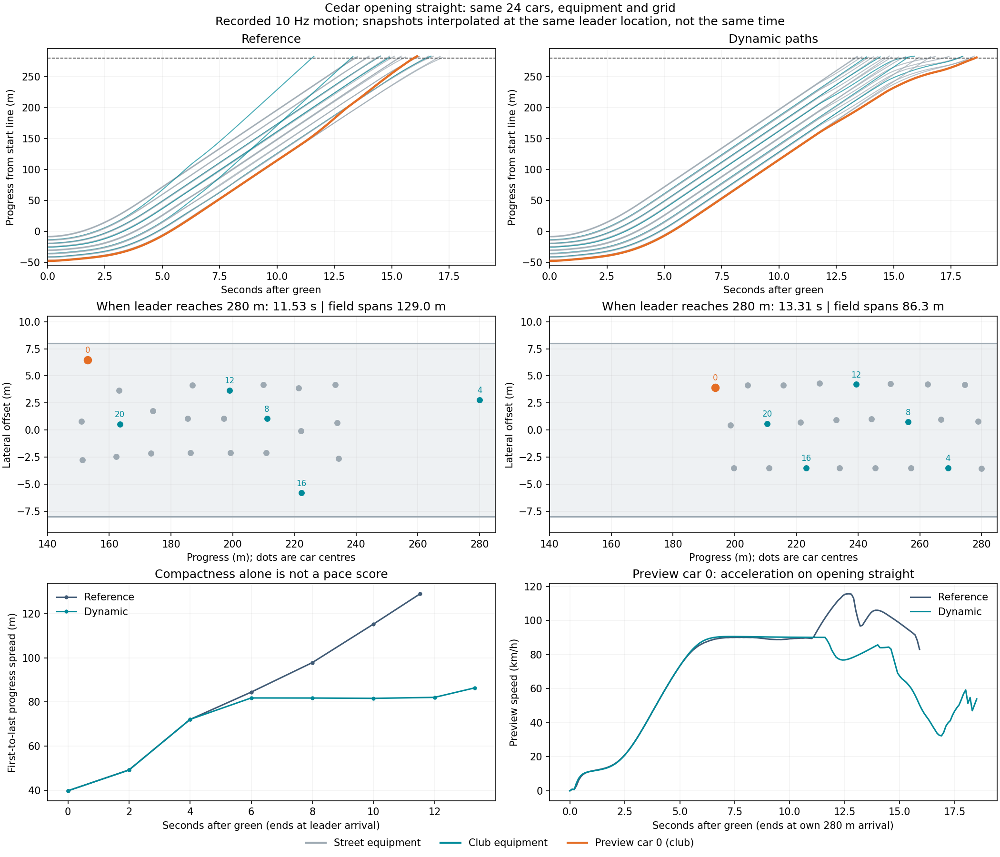

# Opening-straight regression and throttle evidence

The user reports a marked improvement in cornering in the 81 replay, but more following on straights. Reusable analyses now record each car's interpolated positions, route gaps, ranks, gate times and the first-to-last distance from the grid to the authored first braking zone at 280 m. A second report measures applied throttle demand per car and for preview/club/street/whole-field groups, splitting grid launch, 0–200 m, and the 200–280 m corner approach.

## What changed

| Measure | Reference 71 behaviour | Dynamic 81 |
|---|---:|---:|
| First car reaches 280 m | 11.530 s | 13.313 s |
| Last car reaches 280 m | 17.188 s | 18.605 s |
| Field spread when leader reaches 280 m | 129.002 m | 86.341 m |
| Preview reaches 280 m | 15.977 s | 18.567 s |
| Preview rank at 280 m | 17 | 23 |
| Preview average throttle, 0–200 m | 53.4% | 39.2% |
| Club average throttle, 0–200 m | 57.3% | 44.1% |
| Club time at >=95% throttle, 0–200 m | 20.4% | 0.0% |

The opening costs an additional **14.951 combined car-seconds**. The preview loses **2.590 seconds** by 280 m, despite finishing the lap 3.874 seconds faster: later sections recover about 6.464 seconds. A compact field alone therefore is not evidence of good racing. Straight-line throttle is an applied input measure, not engine power or actual acceleration; no rule should blindly reward full throttle where braking is physically required.

## Verified cause in three captured preview decisions

An unchanged 81 instrumented run exactly reproduces all reference samples, events and official results. It captures applied pedal stages and opening path choices. At approximately 6, 8 and 10 race seconds the ordinary follower requests full throttle, while the same-corridor leader limit reduces the final pedal to roughly 55%, 38% and 38%. At those samples neither scenery nor emergency control further reduces the pedal. These are specific observations, not a causal attribution of every limited sample.

The existing editor diagnostic exactly reproduces 3/3 original nominal path checks from those captured states. The six-candidate generator centres passing sides on car 23, which is alongside in the middle column and only about 0.6–1.0 m ahead by route progress. Car 21, about 11 m ahead in the preview's own outer column, is the blocking leader. The generated offsets around the middle-column car do not include the outer route around car 21. Holding the current path wins and is physically checked; following control then limits speed on that blocked path.

This supports changing which opponent supplies passing targets, rather than simply weakening the following brake/spacing limit. Prototype 82 will prefer the forward car that limits attainable pace in the current corridor, retaining the old choice when no such car exists. It preserves the six-candidate budget, two physical checks and all ordinary vehicle limits. Its counterfactual replay and full-field result are separate evidence; a viable short forecast alone cannot establish a completed pass.

## Measurement limits and regression use

The reports use 10 Hz car-centre observations, interpolate spatial gate crossings, and approximate pedal exposure by holding each recorded value to the next sample. Group means are weighted by car-seconds. Centre gaps ignore lateral spacing and are not collision clearance. Exact checkpoint events remain authoritative for race progression. Four arithmetic witnesses cover clipped pedal intervals, missing telemetry, start-line crossings and tied ranks/field spread.

Use opening arrival, per-car progress and throttle alongside full-lap pace, incidents and corner exit results. Preserve the improved cornering. The 81 frame-time spikes, stronger collision, remaining unresolved plans and controlled deadline failures are still open; no production promotion follows this diagnosis.

Evidence: `dynamic-field-81/opening-straight-analysis.json`, its Markdown table and plot; `straight-throttle-analysis.json` and table; `opening-audit` raw run, exact parity, selected-state input provenance and replay; tools `analyze-opening-straight.py`, `plot-opening-straight.py`, `analyze-straight-throttle.py`, `test-straight-telemetry.py` and `capture-opening-81.ps1`.
